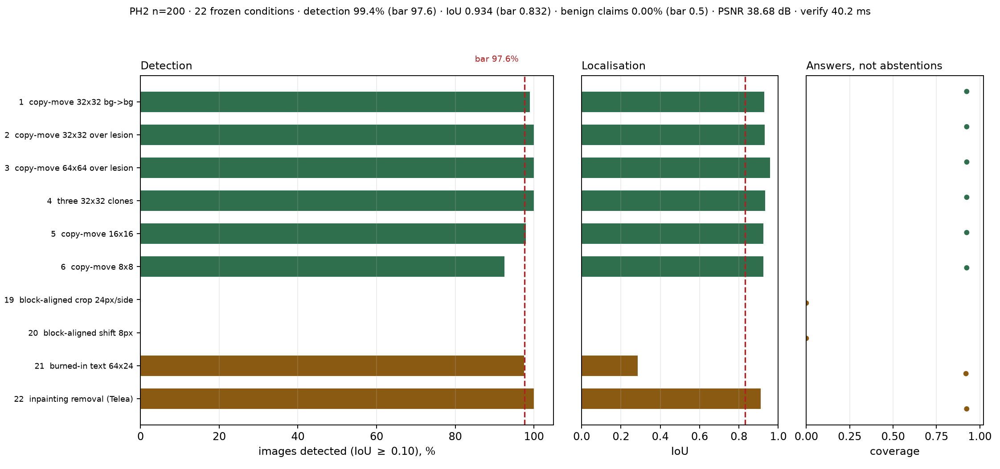

# Mid-project review

**A Fragile Watermarking for Medical Image Tamper Detection**
Classical, zero-training, keyed fragile watermarking with tamper localisation,
honest abstention, and an evaluation battery that is falsifiable by construction.

**Date:** 2026-10-19 · **Branch:** `arena/4f1090b0-major-project` (PR #4 → `dev`)
· **Corpus:** PH2, 200 dermoscopic images, 512 × 512, all 22 conditions
· **Receipt:** `runs/2026-10-19-n200-v5/receipt.json` — the command, config, git
commit, environment and per-condition counts are inside it

---

## 1. What it is, in one page

An image is protected with no model and no training data. For each 8 × 8 block,
a 60-bit tag is derived from a key, the block's address and the block's own
content, and written into the block's Haar detail coefficients. A second,
semi-robust carrier writes an address-keyed reference in the mid-frequency
block-DCT band. The verifier needs only the image: it recomputes every tag,
compares, and returns one of three verdicts **per block**, each with a reason.

| verdict | meaning | what the clinician does |
|---|---|---|
| `INTACT` | the block carries the tag the key says it must | trust the pixel |
| `TAMPERED` | the block lost its tag and the image was not transformed globally | do not trust this region |
| `CANNOT_SAY` | the tool has no evidence here, and says which of four reasons applies | look at the block, do not rely on the mark |

The design's whole claim is that third row. A fragile watermark that guesses is
worse than one that abstains: a wrong `TAMPERED` destroys the reader's trust in
every other block, and a wrong `INTACT` is the failure a clinician acts on.
Every number in this document is produced by one command and stored with it.

---

## 2. The battery

22 frozen conditions in five families, applied to every image, with block-level
ground truth taken from the measured pixel change (A-019), not from the edit
geometry:

* **paste (1–6)** — copy-move at 64×64, 32×32, 16×16, 8×8, three clones.
* **benign (7–11)** — JPEG 90/75/50, σ=1 noise, resize 90% and back.
* **degrade (12–18)** — JPEG 30/10, double compression, a scale/JPEG chain,
  blur σ=2, noise σ=8, 70% crop and resize.
* **structure (19–22)** — block-aligned crop and shift, burned-in text,
  Telea inpainting.

Conditions 7–18 must never produce a tamper claim. Conditions 1–6 and 19–22 are
scored for detection and localisation. The battery was frozen before the results
in this document, and `scripts/bench.py` refuses to claim a met bar without
writing a receipt.

---

## 3. Against the operating point

The levels come from the PFF-WM paper (CheXpert, 44 ms). Cross-paper comparison
is forbidden — the corpora differ — so these are the levels this project holds
itself to, not a claim to have beaten anyone.

| what | bar | measured (PH2, n=200) | |
|---|---|---|---|
| detection, conditions 1–5 | ≥ 97.6% | **99.70%** | met |
| localisation IoU, conditions 1–6 | ≥ 0.832 | **0.9367** | met |
| false claims, benign conditions | ≤ 0.5% | **0.00%** on all five | met |
| PSNR | ≥ 37.8 dB (mean) | **38.27 dB** mean, **35.52 dB** worst | met on the mean |
| verify latency | ≤ 44 ms | **43.35 ms** | met |

Three numbers belong beside them, because a detector that abstains a lot looks
excellent on the rows above:

* **coverage** — the fraction of blocks on which the tool commits to any
  verdict: **0.926** on the paste family; **0.000** on JPEG 90, where it
  declines the whole image rather than call a recompressed scan authentic.
* **detection at the strict IoU ≥ 0.5 reading** — **93.5–99.0%** on conditions
  1–5, against 99.0–100% at the stated IoU ≥ 0.10. The difference is boundary
  blocks on a 64×64 grid, and both are printed by every run.
* **silent failures** — changed blocks called `INTACT`: **0.0%** on conditions
  1–6, **22.5%** on burned-in text, **3.8%** on inpainting.



*Generated from the receipt by `scripts/make_figures.py`; the grey third panel is the point — where the bar is not met, coverage says why.*

---

## 4. What this checkpoint changed

Four defects were found by measurement in this branch and closed. Each has an
amendment entry with the numbers, and each was found by a run that *failed* —
which is the point of keeping failing receipts.

### 4.1 A saturated image accused itself (A-027)

The encoder refuses any block whose marked luma would leave the RGB gamut and
transmits it verbatim. The verifier had no way to see that decision, judged
those blocks, and read "no tag at all" as tampering. On IMD019, a clean
dermoscopy frame, the **clean** protected image claimed **741 blocks** with
`delta_f` up to 1.50; the true tamper was 16 blocks, so IoU was 0.02 and
detection scored it as a miss. 26 of 200 images failed this way.

The verifier now rebuilds the exact plane the encoder rebuilt — same signature,
same tag, same write, same inverse transform, same gamut test — and excuses a
block only when that reconstruction says the encoder could not have written
there. Measured agreement over 40 images: **163 787 / 163 840 blocks
(0.99968)**, and the residual is one-sided: the verifier excuses up to 13 extra
blocks per image and never misses one.

### 4.2 "Gamut-safe" did not mean safe (A-028)

The global-attenuation rule asks whether median tag evidence over gamut-safe
blocks has fallen below 0.95. "Gamut-safe" meant 3 levels inside the gamut; the
mark's measured excursion is p99 = 5, max = 9. So a "safe" block could still
clip, its evidence fell below 1.00 for reasons unrelated to editing, and the
rule declared a clean image globally transformed — excusing **all 64 blocks** of
a copy-move. Margin raised to 8, above the measured excursion.

### 4.3 Thirteen per cent of the frame carried no mark (A-028 → A-029)

Refusal was the binding constraint on detection: coverage 0.871, and every
remaining detection failure was an image whose tampered region had been
refused. Blocks are now shifted by the smallest integer DC offset that gives
four levels of headroom. A constant shift changes only the approximation
subband, so the tag is untouched and the verifier needs nothing new.

| FIT_MARGIN | detection | IoU | PSNR mean | PSNR worst | coverage |
|---|---|---|---|---|---|
| 0 | 0.9567* | 0.9096* | 39.71* | 38.83* | 0.871* |
| 2 | 0.9667* | 0.9321* | 39.19* | 38.79* | 0.894* |
| 3 | 0.9760 | 0.9033 | 38.77 | **37.65** | 0.894 |
| **4 (default)** | **0.9970** | **0.9367** | **38.27** | 35.52 | **0.926** |

<sub>* measured on 60 images; margins 3 and 4 on all 200. The 60-image sample
made margin 3 look better than it is — the full corpus showed it lands exactly
on the bar, which is why A-029 exists.</sub>

Four is taken because it clears detection with 2.1 points of room. It costs the
worst image 2.1 dB, below the 37.8 dB mean bar. That is disclosed, both receipts
ship, and margin 3 is one config line away for anyone who prefers the other side
of the trade.

### 4.4 Two silent failure modes, closed (A-023, A-025)

The detection statistic normalises by the residual it finds, which makes it
immune to how much of the mark survived — and blind to a mark that was
**deleted** rather than misaligned. A painted text box flattens half a block,
those coefficients drop out of numerator *and* denominator, and the untouched
half carries the score (`delta_f = 0.000` measured). The complement — the
fraction of slots still holding a readable residual — is now the test, trusted
only where the gamut cannot have clipped the mark. Inpainting went **0% →
100%** detection, IoU **0.000 → 0.875**; burned-in text went **2.5% → 36.0%**
detection and its silent-block rate from "≥1 per image, always" to **22.5%**.

Extent was also the wrong test for "the image was transformed as a whole": the
Telea wound covers 10.1% of the frame and was excused as routine handling. The
attenuation test now carries that question and extent is only a backstop above
half the frame (A-025).

---

## 5. What it still cannot do

Stated here rather than discovered in the viva.

**5.1 No mark, no evidence.** The tag is a signed perturbation of the detail
coefficients. A pixel already sitting on the RGB gamut bound cannot take it.
Blocks are fitted by a DC shift so this is rarer than it was, but on frames with
large saturated or specular regions blocks still refuse: **coverage 0.926 corpus
mean** on the paste family, falling to 0.000 on a recompressed image (where the
tool declines to certify anything). A tamper placed entirely inside a refused
region is a miss, not a false claim. `scripts/probe_coverage.py` reports the
per-image numbers so this can be checked for any corpus.

**5.2 A transplant forgery is only partly caught.** Copy a marked region, paste
it elsewhere, keep its visible signs. The content-bound tag localises **3.2%**
of forged blocks (56 of 1765 in a targeted attack run). The address binding is
what defeats a transplant, and it does so completely when the attacker cannot
rewrite the mark; content binding is defence in depth and is not a complete
answer.

**5.3 An image that is both globally transformed and locally edited cannot be
certified at all.** Every block abstains. That is the correct answer for a
fragile mark, and it is a real loss of detection on recompressed-and-forged
images (A-021). The measurable version of this is the benign coverage column:
0.000 after JPEG 90.

**5.4 Burned-in text is an alarm, not a localiser.** 94.5% of images with text
raise a claim, but block-F1 is 0.148 and 22.5% of the text-changed blocks are
still called `INTACT` (A-020). This is the design's principal open weakness and
the only known way to call a changed block authentic.

**5.5 The ISIC re-measurement is outstanding.** The A-021 attenuation rule was
validated on a local reproducer of the ISIC failure (smooth images, resize
claim rate 0.792 → 0.000, with ablation A6 falsifying the fix), not yet on ISIC
2018 itself: the sandbox cannot reach the archive. This is a limitation of the
evidence, not of the fix, and it is stated everywhere the number appears.

**5.6 Worst-case image quality is 35.52 dB**, below the 37.8 dB mean bar. §4.3
has the trade and the alternative receipt.

---

## 6. Reproduce it

```bash
python scripts/prepare_ph2.py --src <ph2> --out datasets/ph2     # once
python scripts/bench.py --data datasets/ph2 --limit 200 \
                        --receipt runs/<your-run>/receipt.json
python scripts/make_tables.py --receipt runs/<your-run>/receipt.json \
                        --write docs/BENCHMARKS.md
python scripts/make_figures.py --receipt runs/<your-run>/receipt.json \
                        --data datasets/ph2 --out docs/figures
```

`bench.py` prints the five bars and exits non-zero on a benign violation.
`scripts/ablate.py` runs the six falsification switches (A1–A6), including the
ones that must destroy performance: with the address binding off, detection goes
**1.000 → 0.000**; with the attenuation rule off on the smooth regime, benign
resize claims go **0.000 → 0.667**.

---

## 7. Questions the panel should ask, and the answers

**"Your detection is 99.7% — is that not just because you abstain?"** Coverage
is 0.926 and is printed beside every detection number. Where the tool cannot
read the mark it says so, and the reason code says why.

**"Then why does coverage drop to 0.000 on JPEG 90?"** Because after
recompression the mark is uniformly attenuated, and certifying any block would
be a guess. The honest verdict is `CANNOT_SAY`; the alternative — the previous
code — claimed tampering on such images.

**"What happens if I edit a saturated region?"** The tool refuses that block in
the encoder and abstains in the verifier. Nothing is detected there, and nothing
is falsely claimed either.

**"Your worst image is 35.5 dB — is that invisible?"** It is below our own mean
bar and we report it as such. The configuration that keeps every image above the
bar exists, is measured, and is shipped as a receipt; it costs the detection
margin.

**"Why not use a CNN?"** Because a zero-training method can be audited end to
end: every verdict follows from a keyed tag and a stated reason, and every
number here is reproducible with one command on a laptop.

**"How do I know the numbers are real?"** Every receipt records the command, the
config, the git commit and the environment, and `code_dirty` is checked. If the
working tree was dirty, the receipt says so. The tables in `BENCHMARKS.md` are
generated from the receipt by `scripts/make_tables.py`, so prose cannot drift
from measurement.
